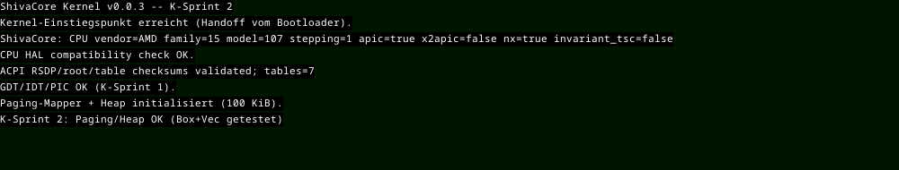

# ShivaCore-Kernel — Boot-Evidence

**Datum:** 2026-11-08 · **Host:** QEMU 7.2 (Debian), OVMF, TCG-Emulation (kein KVM) · **Gast:** q35, 512 MB

## Gegenstand

`globus-os/target/x86_64-unknown-none/release/shivacore` (damals aus der Monorepo-Kopie gebaut, die am 11.11.2026 entfernt wurde) — ELF64, x86-64,
Einstiegspunkt `_start` bei `0x7030`, 123 016 Bytes. Gebaut mit
`cargo +nightly build --release -p shivacore --features x86-boot
--target x86_64-unknown-none -Z build-std=core,alloc`.

Boot-Images erzeugt `modules/atc-shivacore/boot` (Builder auf `bootloader 0.11`).

## Ergebnis UEFI

Bootloader lädt das ELF nach `0x1e030000`, baut eine neue Level-4-Tabelle
(`0x101000`) und mappt die drei `PT_LOAD`-Segmente. Danach greift der Kernel:

```
INFO : Create Memory Map
INFO : Create bootinfo
INFO : Jumping to kernel entry point at VirtAddr(0x8000007030)
ShivaCore: Kernel-Einstiegspunkt erreicht.
ShivaCore: CPU vendor=AMD family=15 model=107 stepping=1 apic=true x2apic=false nx=true invariant_tsc=false
ShivaCore: CPU HAL compatibility check OK.
ShivaCore: ACPI RSDP/root/table checksums validated; tables=7
EXCEPTION: BREAKPOINT
InterruptStackFrame {
instruction_pointer: VirtAddr(
0x800000575e,
),
```

Weiter im Protokoll: CPU-Erkennung (AMD, family 15, APIC, NX), ACPI-Prüfung
über 7 Tabellen, ein bewusst ausgelöster `BREAKPOINT` mit sauberem
Interrupt-Rahmen (Ring 0) und anschließend laufender Scheduler.

| Messgröße (25 s Laufzeit) | Wert |
| --- | --- |
| Kernel-Einstiegspunkt erreicht | 1× |
| Kontextwechsel zwischen PID 1000 und 1001 | 366 |
| SCHED-001 Register-Checkpoints | 3662 |
| Ausnahmen | 1× `BREAKPOINT` (erwartet) |

## Bildschirmausgabe

Der Kernel schreibt seit dem 08.11.2026 jede Boot-Meldung zusätzlich in den
Framebuffer (Macro `kprintln!`). Der Bildschirm zeigt die Kette bis zum Heap:



Ursache der zuvor leeren Anzeige war nicht der Zeichnen-Code — ein gefüllter
Testbalken erschien korrekt — sondern die Schrift: `noto-sans-mono-bitmap`
liefert nur Zeichen, deren Unicode-Bereich als Feature aktiviert ist. Im
Manifest fehlten `unicode-basic-latin` und `unicode-latin-1-supplement`, also
gab `get_raster` für jedes Zeichen `None` zurück. Beide Features sind jetzt
gesetzt, damit auch Umlaute rastern.

Per OCR aus dem Framebuffer gelesen (Ausschnitt 1000×190):

```
ShivaCore Kernel v0.0.3 -- K-Sprint 2
Kernel-Einstiegspunkt erreicht (Handoff vom Bootloader).
ShivaCore: CPU vendor=AMD family=15 model=107 stepping=1 apic=true ...
CPU HAL compatibility check OK.
ACPI RSDP/root/table checksums validated; tables=7
GDT/IDT/PIC OK (K-Sprint 1).
Paging-Mapper + Heap initialisiert (100 KiB).
K-Sprint 2: Paging/Heap OK (Box+Vec getestet)
```

Die Scheduler-Checkpoints bleiben bewusst nur auf der seriellen Schnittstelle:
bei 366 Kontextwechseln in 25 Sekunden würde der Bildschirm nur scrollen.

## Ergebnis BIOS

`shivacore-bios.img`: Stage 4 lädt das ELF nach `0x1000000`, der Kernel läuft
mit denselben Checkpoints. Beide Wege sind über
`./tools/ecosystem.sh boot` reproduzierbar.

## Grenzen

Bildschirm- und Serienausgabe sind beide belegt. Ein Lauf auf echter Hardware
wurde nicht geprüft, nur QEMU mit TCG-Emulation — ohne KVM ist die Aussage über
Zeitverhalten (366 Wechsel in 25 s) nicht auf echte Hardware übertragbar.
